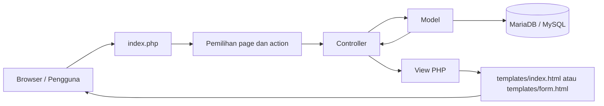
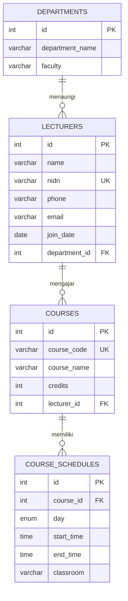

# TP8DPBO2425C1

## Janji
Janji: Saya Muhammad Ilal Zhafran dengan NIM 2502623 mengerjakan Tp 8 dalam mata kuliah DPBO untuk keberkahanNya maka saya tidak melakukan kecurangan seperti yang telah dispesifikasikan. Aamiin

## 2. Tujuan Program

- Menyimpan dan mengelola data akademik.
- Menyediakan operasi Create, Read, Update, dan Delete (CRUD) untuk setiap modul.
- Menghubungkan data antarentitas menggunakan foreign key.
- Menerapkan pemisahan tanggung jawab dengan arsitektur MVC.

## 3. Aktor dan Fitur

| Aktor | Fitur |
|---|---|
| Pengguna aplikasi | Melihat, menambah, mengubah, dan menghapus data dosen |
| Pengguna aplikasi | Melihat, menambah, mengubah, dan menghapus data departemen |
| Pengguna aplikasi | Melihat, menambah, mengubah, dan menghapus data mata kuliah |
| Pengguna aplikasi | Melihat, menambah, mengubah, dan menghapus jadwal mata kuliah |

## 4. Arsitektur Program

## 5. Alur Kerja Request

1. Pengguna membuka tautan atau mengirim form dari browser.
2. Request masuk ke `index.php` dengan parameter `page` dan `action`.
3. Router memilih controller yang sesuai.
4. Controller memanggil model untuk membaca atau mengubah data.
5. Model berkomunikasi dengan database menggunakan query berparameter.
6. Untuk halaman daftar atau form, controller mengirim data ke view.
7. View dirender bersama template dan dikirim sebagai HTML kepada browser.
8. Setelah operasi simpan atau hapus, aplikasi mengarahkan pengguna kembali ke daftar modul.

## 6. Rancangan Modul dan Routing

| Modul | `page` | Aksi yang ditangani | Controller | Model |
|---|---|---|---|---|
| Dosen | `lecturers` | `index`, `create`, `store`, `edit`, `update`, `delete` | `LecturerController` | `Lecturer` |
| Departemen | `departments` | `index`, `create`, `store`, `edit`, `update`, `delete` | `DepartmentController` | `Department` |
| Mata kuliah | `courses` | `index`, `create`, `store`, `edit`, `update`, `delete` | `CourseController` | `Course` |
| Jadwal | `schedules` | `index`, `create`, `store`, `edit`, `update`, `delete` | `CourseScheduleController` | `CourseSchedule` |

## 7. Rancangan Database

